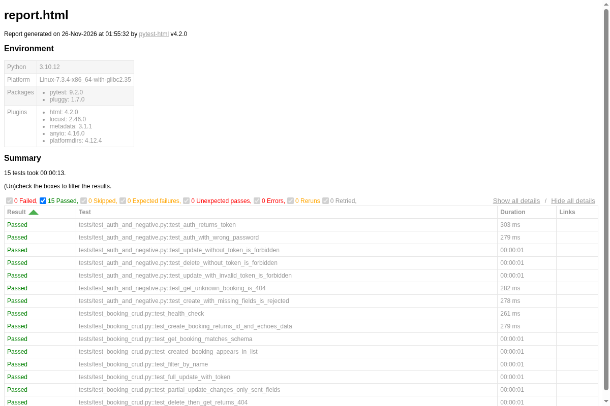

# Restful-Booker API tests

pytest + requests tests for the [Restful-Booker](https://restful-booker.herokuapp.com) practice API (a hotel booking service). This one covers a full CRUD flow with token authentication, which is different from the read-only style tests in my other API projects.



## What is covered

- **CRUD flow:** create, read, list, filter by name, full update (PUT), partial update (PATCH), delete and check 404 afterwards
- **Auth:** token creation, bad credentials, update and delete without a token or with an invalid one (403)
- **Negative cases:** unknown booking id, create with missing fields
- JSON schema check on the booking response
- Each test creates its own booking in a fixture and deletes it at the end, so tests do not depend on each other

15 tests.

## Run it

```bash
git clone https://github.com/Belaalos/booking-api-qa-suite.git
cd booking-api-qa-suite
python -m venv .venv && source .venv/bin/activate   # Windows: .venv\Scripts\activate
pip install -r requirements.txt
pytest
```

HTML report goes to `reports/report.html`. The suite also runs on GitHub Actions.

## Things I noticed

- Wrong credentials on `/auth` return **200** with `{"reason": "Bad credentials"}` instead of 401. The test checks for that behaviour on purpose.
- Creating a booking with missing fields returns **500** instead of a 4xx validation error (test only asserts status >= 400).
- The server is shared and gets reset now and then, so the cleanup in the fixture is best effort.

Belal Magdy | QA | [LinkedIn](https://www.linkedin.com/in/belal-magdy-23sep2001)
